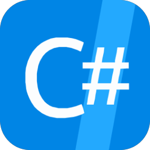

  

<h1 align="center">C# Shell .NET IDE</h1>

  A complete C# / .NET IDE that runs on your Android device — no PC, no server, no emulator.

<!-- Each <a> wraps its  on one line on purpose: whitespace inside the anchor renders as
     underlined link text. align="middle" is what GitHub's sanitizer allows for vertical centring;
     the Play badge PNG carries transparent padding, hence its larger height. -->

  &nbsp;&nbsp;

This repository is the public home of the app: it is where issues are tracked and where the
[FAQ](FAQ.MD) lives. The app's source code is not published here.

## What it does

Write, compile, run and debug real .NET code on the phone or tablet you already have. The app ships
the CoreCLR runtime and the Roslyn compiler, so everything happens on the device.

- **Editor** — C# 12+ with syntax highlighting, Roslyn-powered IntelliSense, real-time error
  checking, quick fixes and refactorings, find & replace, multiple themes.
- **Run, debug, test** — console apps and full .NET MAUI apps, a step-through debugger with an
  object inspector, and a built-in xUnit test runner.
- **Ship it** — export a runnable assembly, pin a home-screen shortcut to it, or build, sign and
  install an APK of the app you just wrote.
- **Projects & source control** — multi-project solutions, a Solution Explorer, a dual-pane file
  manager, NuGet package management, and built-in Git with a side-by-side diff viewer.
- **AI coding assistant** — a chat that can read, search and edit your files and run your code,
  backed by an on-device model, Ollama, OpenRouter or any OpenAI-compatible API, with MCP tool support.
- **Learn** — built-in examples and practice tasks.

The app is free and shows ads; a one-time Premium purchase removes them.

## Which download?

- **Google Play** is the release channel for almost everyone: automatic updates, and the app's
  purchases work through it.
- **GitHub Releases** carries a signed APK of the same app for people who prefer a direct download.
  It is signed with a different certificate, so it cannot install over a Play-installed copy (and
  vice versa) — uninstall one before installing the other. It updates itself from here when you tap
  the version line in the menu.

## Before you open an issue

This is not Visual Studio, and Android is not Windows. Windows-only technologies — WPF, UWP,
Windows Forms, the Windows API and libraries built on them — cannot work here at all. Please read the
[FAQ](FAQ.MD) first; most questions are already answered there.

When you do open an issue, include the app version (menu → the version line), your device model and
Android version, and the exact error text.

### System requirements

The app runs a full .NET runtime and compiler on your device, so it needs real memory.

- **Minimum:** 3 GB RAM. Below this the system will close the app while it is in the background.
- **Recommended:** 6 GB RAM or more and a 2 GHz 8-core CPU for smooth use without freezes.
- About 1 GB of free storage to install, even though the app itself is around 350 MB.

Running a MAUI or ASP.NET Core app you have written starts a second process, which increases memory use.

## Attributions

Icons by [SmashIcons / Flaticon](https://htmlpreview.github.io/?https://github.com/radimitrov/CSharpShellApp/blob/master/SmashIcons_FlatIcon_Attributions.html).
